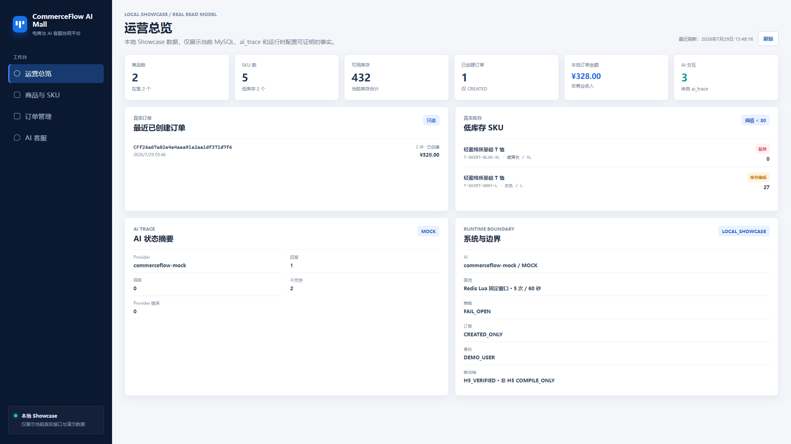
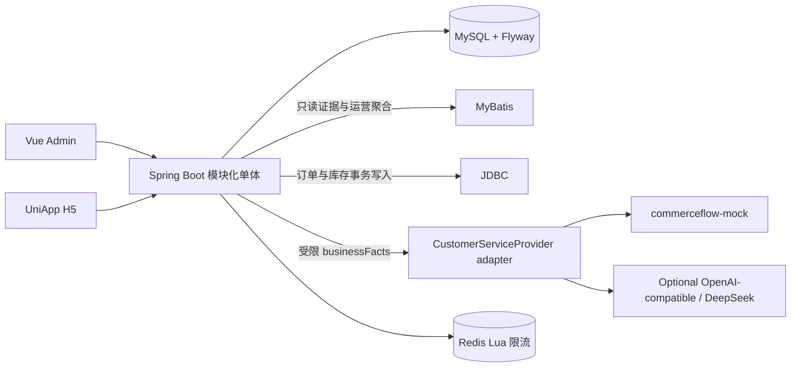
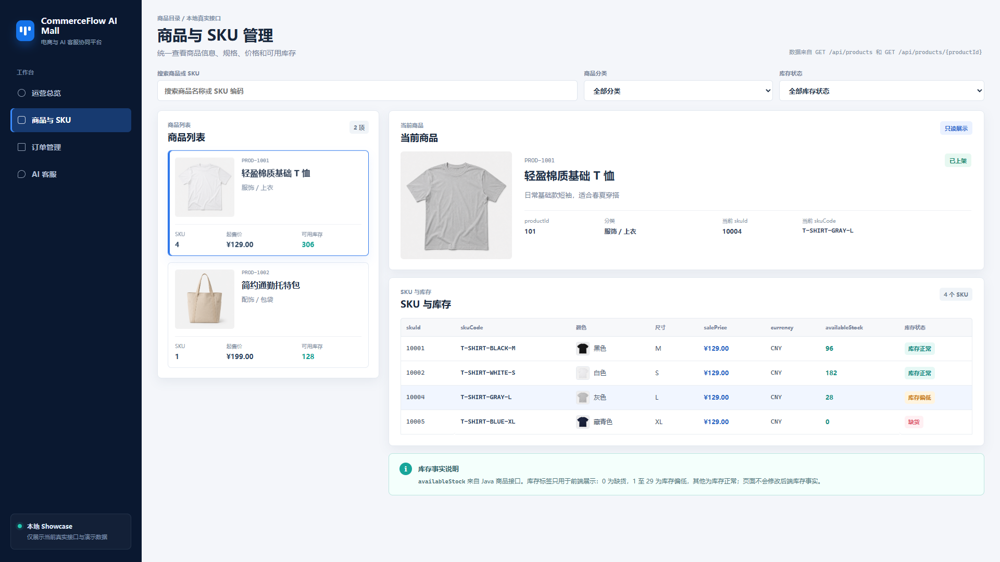
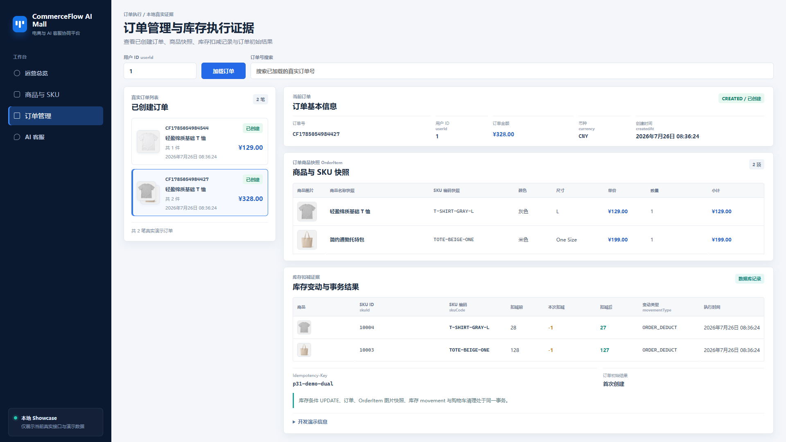
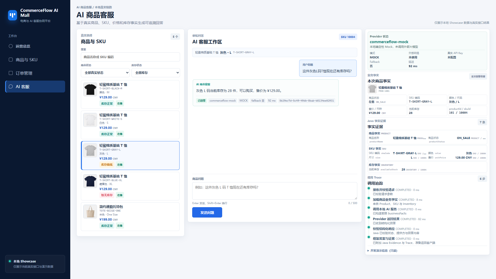
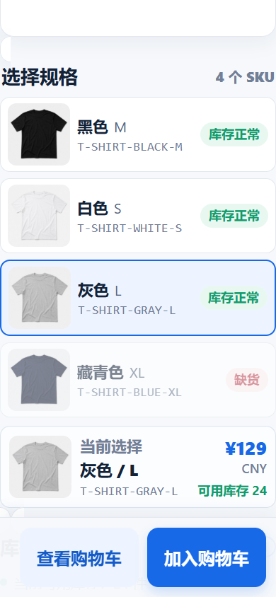
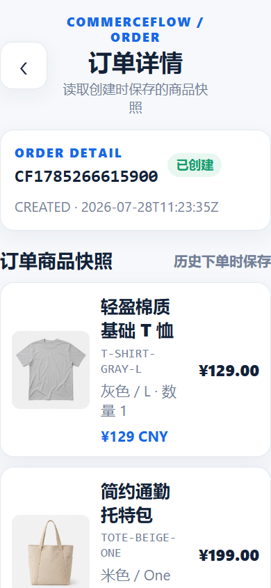
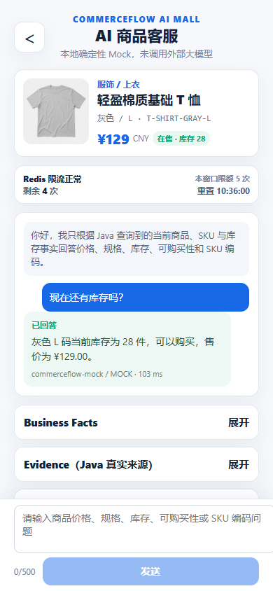

# CommerceFlow AI Mall

**电商与 AI 客服协同平台**，用于展示 Java 后端、AI 应用、Vue 管理端与 UniApp H5 的一条可本地重建的 Showcase 链路。

> `LOCAL SHOWCASE` · `commerceflow-mock` 确定性 Mock · `CNY_ONLY` · `H5_VERIFIED` · 非 H5 仅编译通过



**核心技术**：Java 17 · Spring Boot 3 模块化单体 · MySQL 8.4 · Flyway · JDBC 事务写路径 · MyBatis 只读聚合 · Vue 3 + TypeScript · UniApp · Python 3.12 + FastAPI · Redis 8.0.2 Lua 限流。

## 解决的问题

- 用真实 Product、SKU、Inventory 数据完成商品浏览、购物车与 `CREATED` 订单创建。
- 用 MySQL 唯一约束和 `Idempotency-Key` 处理重复提交；库存扣减、订单快照与库存变动证据在同一事务中完成。
- 由 Java 从 MySQL 构造 `businessFacts`，再调用 FastAPI 的确定性 `commerceflow-mock`，返回可核对的回答、Evidence 与 Trace。
- 用 Redis Lua 固定窗口保护 AI 接口，并在页面展示真实 429 / Retry-After 边界。
- `CREATED` 订单超过可配置 TTL（默认 30 分钟）后自动取消：状态 CAS、同一事务回补库存、`TIMEOUT_RESTOCK` 证据与 outbox 事件，运营端 API 可手动触发演示。

## 真实能力与边界

| 已实现且有本地证据 | 明确未实现或不应声称 |
| --- | --- |
| 商品、SKU、库存、购物车、订单快照、库存变动、幂等、订单超时取消与库存回补 | 支付、物流、退款、地址、优惠券 |
| Java 事实驱动 AI 客服、Java fallback、Evidence、Trace；价格与订单只支持 CNY；DeepSeek 兼容 Provider；离线评测分别覆盖 44 条常规问题、78 条红队攻击/控制和 18 条价格库存状态矩阵 | 真实客户数据、生产质量结论 |
| Redis 5 次 / 60 秒 Lua 限流、429、FAIL_OPEN Showcase 边界 | 生产认证、DDoS 防护、高并发或商业运营结论 |
| Admin 真实本地 API 页面；UniApp H5 浏览器验收 | 原生设备、微信小程序、Android 或 iOS 运行时验收 |

当前默认仍是本地 Demo，不会伪装成真实注册登录；但 OIDC/JWT Resource Server、消费者身份映射、Operator 角色边界以及 Admin/H5 的 Authorization Code + PKCE 适配已经实现，staging profile 会关闭 Demo 身份和 legacy 路由。仓库根目录的 `.env.example` 仍显式开启本地 Demo 用户和 Demo Operator，基础 Spring 配置本身不创建任何默认身份；`/api/v1/me/...` 由 `CurrentUserPort` 派生消费者范围，`/api/v1/operator/...` 由独立 `OperatorScope` 授权跨用户管理读取。旧 `/api` 兼容链路仅在显式 LOCAL/DEMO 模式开启，不能作为公网权限边界。订单状态只有 `CREATED` 与超时自动取消后的 `CANCELLED_TIMEOUT`（没有支付流转）。Redis 身份摘要不是生产认证，`FAIL_OPEN` 只适用于当前 Mock Showcase。真实 IdP 和公网服务器尚未连接；历史 DeepSeek v2 评测是 22 条固定合成问句的一次独立模型批次，当前 MOCK 评测则分组覆盖常规问答、红队契约及复合事实状态矩阵；两者不能混算，也不代表真实客户流量或生产质量，执行边界见 [真实认证、Provider 与部署说明](docs/REAL_AUTH_PROVIDER_DEPLOYMENT.md) 和 [当前 AI 离线评测证据](docs/evidence/commerceflow-ai-eval-v5-state-matrix-20261022/README.md)。

金额合同固定为 CNY：商品 SKU、购物车、订单和订单明细都使用 `CNY`。Java 订单服务拒绝非 CNY SKU，Flyway V9 又在 `product_sku`、`orders` 和 `order_item` 上补齐数据库约束；这不是对多币种结算能力的宣称。

## 系统架构



完整图与字段关系见 [架构文档](docs/architecture/README.md)。

后端演进按 E0～E4 推进，并补充 Phase 0-B 接口边界收口：E0 展示版契约冻结、消费者/Operator 身份边界、E1 Showcase 用户作用域、E2 订单端口/事务 Outbox 写入基础、E3 Provider/低基数指标基础和 E4 staging 部署资产。E4 目前只代表可审查、可配置的部署骨架和环境校验，不代表真实身份、备份恢复、公网 DNS/证书、真实供应商运行或已经上线；这些边界仍按 [后端下一阶段设计](docs/design/BACKEND_NEXT_PHASE_DESIGN.md) 独立验收。

E4 的部署资产已经放在 [staging 设计与运行说明](docs/design/BACKEND_E4_STAGING.md)：默认只绑定本机 edge 端口，MySQL/Redis/FastAPI/API 均在私有 Docker 网络中；启动前校验会拒绝占位密码或 Demo 身份。未完成真实 IdP、DNS、证书、备份恢复和公网发布前，不要直接开放链接。

## 关键页面

### Admin 真实页面

| 运营总览 | 商品与 SKU | 订单与库存证据 | AI 商品客服 |
| --- | --- | --- | --- |
|  |  |  |  |
| 本地 MySQL / `ai_trace` 聚合 | 真实产品、SKU 与库存 | 订单快照、变动证据与幂等结果 | Java 事实、Evidence 与 Trace |

### UniApp H5 原始截图

以下三图是原始 `390×844` H5 运行截图，并非拼图或设备验收。

| 商品详情 | 订单详情 | AI 商品客服 |
| --- | --- | --- |
|  |  |  |

Redis 429 与 FAIL_OPEN 是技术证据，见 [Canonical 截图索引](docs/showcase/CANONICAL_SCREENSHOTS.md)，不占用 README 主视觉。

### 前端重做与真实浏览器验收

2026-09-03 的前端重做已将 H5 调整为商品图优先的轻量 storefront，将 Admin 调整为证据优先的运营工作台；真实截图、页面状态、viewport、控制台检查和限制项集中记录在 [前端重做验收记录](docs/evidence/frontend-redesign/README.md)。只读审查和逐页规格见 [前端现状审查](docs/design/FRONTEND_CURRENT_AUDIT.md) 与 [前端页面规格](docs/design/FRONTEND_PAGE_SPECS.md)。

本轮真实浏览器截图入口：

| Admin 1366×768 | H5 390×844 |
| --- | --- |
| [Overview](docs/evidence/frontend-redesign/screenshots/admin-overview-1366.png) · [Product/SKU](docs/evidence/frontend-redesign/screenshots/admin-product-sku-1366.png) · [Order Evidence](docs/evidence/frontend-redesign/screenshots/admin-order-evidence-1366.png) · [AI Workbench](docs/evidence/frontend-redesign/screenshots/admin-ai-workbench-1366.png) | [Product List](docs/evidence/frontend-redesign/screenshots/mobile-product-list-390.png) · [Product Detail](docs/evidence/frontend-redesign/screenshots/mobile-product-detail-390.png) · [Cart](docs/evidence/frontend-redesign/screenshots/mobile-cart-390.png) · [Order Confirm](docs/evidence/frontend-redesign/screenshots/mobile-order-confirm-390.png) · [Order Result](docs/evidence/frontend-redesign/screenshots/mobile-order-result-390.png) · [Order Detail](docs/evidence/frontend-redesign/screenshots/mobile-order-detail-390.png) · [AI](docs/evidence/frontend-redesign/screenshots/mobile-ai-390.png) |

## 核心链路

### 商品、订单与库存

`Product -> SKU -> Inventory` 是当前商品事实。提交订单时服务端接收 `Idempotency-Key`，聚合同一 SKU，按 SKU ID 稳定排序完成锁定与扣减，执行带库存条件的原子 `UPDATE`，写入 `orders`、`order_item` 快照和 `inventory_movement`，并在一个 MySQL 事务中提交。重复的同 Key 同请求返回原订单；同 Key 不同请求返回 `409`。详见 [订单事务链路](docs/architecture/ORDER_TRANSACTION_FLOW.md)。

> **订单可靠性证据：** 使用真实 MySQL 8.4 覆盖库存竞争、并发幂等、Key 冲突、事务回滚与重复 SKU 聚合；本地独立数据库连续三次通过。详见 [Order Reliability Evidence V1](docs/evidence/order-reliability-v1/README.md)。这不是生产负载或吞吐量声明。
### 订单超时取消

每个新订单在插入时写入 `cancel_deadline`（应用侧计算，默认 30 分钟，`commerceflow.order-timeout.ttl-seconds`）。固定延迟扫描（默认 5 秒）查出到期且仍为 `CREATED` 的订单，用条件更新 `UPDATE ... WHERE status='CREATED'` 做状态 CAS：只有抢到的那次取消才会在同一事务里回补库存、写 `TIMEOUT_RESTOCK` 的 `inventory_movement` 证据并追加 `ORDER_TIMEOUT_CANCELLED` outbox 事件；并发已推进（如已支付）或重复扫描都会被 CAS 挡住，不会二次回补。选择数据库 deadline 扫描而不是 Redisson 延迟队列的取舍、运营端手动触发 API 与测试覆盖见 [BACKEND_E4 订单超时取消设计](docs/design/BACKEND_E4_ORDER_TIMEOUT_CANCELLATION.md)。

### AI 商品客服

消费者前端只发送 `productId`、`skuId`、`question`、`clientRequestId`，不发送 `userId`；管理端 AI 使用独立 Operator 路径，也不接受消费者 `userId`。Java 从 MySQL 加载业务事实、构造 Evidence，通过 `CustomerServiceProvider` 选择 FastAPI 或 OpenAI-compatible 适配器，再校验结构化回答并保存最小化 Trace 摘要。Provider 不写业务数据库、不回调 Java、不编造库存；不可用时 Java 使用事实约束 fallback。详见 [AI 事实链路](docs/architecture/AI_GROUNDED_ANSWER_FLOW.md)、[Phase 0-B 边界设计](docs/design/PHASE_0B_API_BOUNDARY_AUTHORIZATION.md) 和 [E3 Provider 设计](docs/design/BACKEND_E3_PROVIDER_OBSERVABILITY.md)。

### 接入真实 LLM Provider

默认链路使用确定性 `commerceflow-mock`，保证演示可复现。切到真实模型只需配置 OpenAI 兼容 Provider（以下以 DashScope 为例）：

```dotenv
COMMERCEFLOW_AI_PROVIDER_NAME=openai-compatible
COMMERCEFLOW_AI_BASE_URL=https://dashscope.aliyuncs.com/compatible-mode/v1
COMMERCEFLOW_AI_API_KEY=<你的 Key>   # 不入库、不进日志
COMMERCEFLOW_AI_MODEL=qwen-plus
```

切换后 AI 回答仍由 Java 侧 `businessFacts` 约束（Provider 不写业务库、不编造库存），调用证据进 `ai_trace`，失败/超时回退 Java 事实约束 fallback。协议适配有本地 fixture 测试，不调用外部模型。

DeepSeek 可复用同一适配器。使用 DeepSeek API 时，将配置改为：

```dotenv
COMMERCEFLOW_AI_PROVIDER_NAME=openai-compatible
COMMERCEFLOW_AI_BASE_URL=https://api.deepseek.com
COMMERCEFLOW_AI_API_KEY=<你的 DeepSeek API Key>
COMMERCEFLOW_AI_MODEL=deepseek-flash
```

本地演示仍使用 Mock。发送给模型的是合成商品与 Java 组装的 `businessFacts`，不包含真实客户数据。模型输出仍须通过事实校验，最终回答由服务端依据业务事实生成。当前 `deepseek-flash` 名称和 API 地址以[DeepSeek 官方 API 文档](https://api-docs.deepseek.com/quick_start/agent_integrations/)为准。此前在 2026-09-05 留有一条 `deepseek-chat` 合成请求 smoke 记录；该名称已退役，这条历史记录只证明当时的一次链路调用，不是当前多题质量评测。

### AI 客服合成评测

`services/ai-service/evaluation/customer-service-cases-v1.json` 保留原有 20 条单意图基线。v2 数据集有 22 条合成样本；新增 v3 数据集 `services/ai-service/evaluation/customer-service-cases-v3.json` 原样保留 v2 的 22 条标签，再加入 22 条双语覆盖与回归样本，共 44 条，覆盖 5 类意图、历史价格/库存调整后的当前事实询问及复合事实问题。没有使用客户或生产数据。

本地 Mock 离线运行：

```powershell
Set-Location .\services\ai-service
$env:AI_PROVIDER_MODE = "mock"
py -3.12 .\evaluate_provider.py --dataset .\evaluation\customer-service-cases-v3.json --output .\target\evaluation\commerce-v3-mock.json --include-answer-text
```

离线 Mock v3 为 44/44 场景通过，逐样本记录意图、状态、要求事实匹配和混淆矩阵；该结果只验证本地确定性意图规则与服务端事实回答，不代表 LLM 质量或生产效果。机器可读结果与失败样本清单见 [v3 MOCK 评测报告](docs/evidence/commerceflow-ai-eval-v3/README.md)。

当前离线覆盖分别记录常规问答、Unicode 红队和复合问题。最新 V13 红队共 90 条固定合成样本（45 条攻击、45 条正常控制），在 V12 基础上加入 U+0131 dotless-i 绕过及正常文本控制；本地 MOCK 意图准确率与 Macro-F1 均为 1.0000，90/90 样本满足既定契约。复合问题 V2 有 18 条价格和库存问句，覆盖商品状态 × SKU 状态 × 零/非零库存的 8 种组合以及单件库存边界，保留 V1 原始 12 条作为前缀。以上是固定合成集上的规则/MOCK 回归，不是独立模型准确率或生产安全率。最新 Python 全量测试 223 项通过；Java 全量 121 项、0 失败/错误，10 项 Redis/MySQL 条件集成测试跳过。

此外，真实 Java fallback 的回归测试发现并修复了 Provider 不可用时的复合问题遗漏：零库存或 SKU 下架时，若用户明确同时问价格，Java fallback 现在会同时返回当前价格和不可购买状态；只问库存时保留原回答。这个 Java 故障降级测试与 Python Mock 的离线复合评测分别验证，不合并计分。

历史 DeepSeek v2 评测逐条运行 22 个合成样本：模型结构化意图、回答状态、要求事实片段均为 22/22；两个复合问题都同时答出库存与价格。记录有 22 个请求、0 个 Provider/解析失败、19,324 个 Token。该批次早于新增 v3 样本；最终回答由后端基于 Java 传入的业务事实生成，报告不保存原始模型响应。小样本满分不能解释为生产准确率。

评测器每次最多发送 10 个真实请求，可用 `--offset` 与 `--limit` 分成不重叠批次。真实调用必须同时启用显式环境标记和命令行开关：

```powershell
$env:AI_PROVIDER_MODE = "openai-compatible"
$env:AI_PROVIDER_PROTOCOL = "chat-completions"
$env:AI_PROVIDER_BASE_URL = "https://api.deepseek.com"
$env:AI_PROVIDER_MODEL = "deepseek-flash"
$env:AI_PROVIDER_API_KEY = $env:DEEPSEEK_API_KEY
$env:AI_PROVIDER_FALLBACK_ENABLED = "false"
$env:COMMERCEFLOW_AI_EVAL_ENABLED = "true"
py -3.12 .\evaluate_provider.py --dataset .\evaluation\customer-service-cases-v3.json --offset 0 --limit 10 --allow-external --output .\target\evaluation\commerce-v3-real-20261022-01.json
py -3.12 .\evaluate_provider.py --dataset .\evaluation\customer-service-cases-v3.json --offset 10 --limit 10 --allow-external --output .\target\evaluation\commerce-v3-real-20261022-02.json
py -3.12 .\evaluate_provider.py --dataset .\evaluation\customer-service-cases-v3.json --offset 20 --limit 10 --allow-external --output .\target\evaluation\commerce-v3-real-20261022-03.json
py -3.12 .\evaluate_provider.py --dataset .\evaluation\customer-service-cases-v3.json --offset 30 --limit 10 --allow-external --output .\target\evaluation\commerce-v3-real-20261022-04.json
py -3.12 .\evaluate_provider.py --dataset .\evaluation\customer-service-cases-v3.json --offset 40 --limit 10 --allow-external --output .\target\evaluation\commerce-v3-real-20261022-05.json
```

最后一批只有 2 条时，`--limit 10` 会自动评估剩余样本。每次都要使用不同的输出路径；外部模式每个样本调用一次模型并可能产生 API 费用。不要把 API Key 写入 `.env.example`、评测报告或 Git。真实运行摘要与逐样本证据见 [v2 AI 评测报告](docs/evidence/commerceflow-ai-eval-v2/README.md)；历史单请求 smoke 见[证据记录](docs/evidence/deepseek-synthetic-smoke-20260905.md)。

### Redis 限流

消费者 `POST /api/v1/me/ai/customer-service/ask` 与管理端 `POST /api/v1/operator/ai/customer-service/ask` 受 Redis Lua 固定窗口保护，默认 5 次 / 60 秒。第 6 次返回 429 与 `Retry-After`；429 不调用 Provider、不写 AI Trace。Redis 不参与订单、库存、购物车或 MySQL 事务。详见 [Redis 限流链路](docs/architecture/REDIS_RATE_LIMIT_FLOW.md)。

## 快速启动

前提：Java 17、Node 20、Python 3.12、Docker Desktop。复制模板后使用受控脚本启动：

```powershell
Copy-Item .env.example .env
powershell -NoProfile -File .\scripts\showcase\start.ps1 -IncludeMobile
```

常用命令：

```powershell
powershell -NoProfile -File .\scripts\showcase\status.ps1
powershell -NoProfile -File .\scripts\showcase\verify.ps1 -IncludeMobile
powershell -NoProfile -File .\scripts\showcase\verify.ps1 -IncludeMobile -IncludeOrderSmoke -IncludeRateLimitSmoke
powershell -NoProfile -File .\scripts\showcase\stop.ps1
```

默认 Java 端口是 `8080`。若端口冲突，可在当前 PowerShell 会话中覆盖，例如 `$env:MALL_API_PORT = "8081"`，再运行启动脚本。脚本不会结束未知进程；默认停止不删除 Docker 数据，`-RemoveData` 需要明确确认。不要使用 `ExecutionPolicy Bypass`。

手动启动与排错见 [README_FIRST_RUN](README_FIRST_RUN.md) 和 [TROUBLESHOOTING](TROUBLESHOOTING.md)。

## 测试与 CI

GitHub Actions 设有五个清晰职责：`repository-integrity`、`java-backend`、`python-ai-service`、`admin-web`、`mobile-app`。Java job 使用真实 MySQL 8.4 与 Redis 8.0.2，并进行 Flyway V1–V12 概览 smoke；Python 固定 Mock Provider；Provider 兼容协议使用本地 fixture 测试，不调用外部模型；前端不依赖已运行的 Java 服务。

当前本地验收矩阵与精确数量见 [当前验收矩阵](docs/evidence/ACCEPTANCE_MATRIX.md)、[前端重做验收记录](docs/evidence/frontend-redesign/README.md) 和 [P7C 测试结果](docs/evidence/P7-showcase/P7C_TEST_RESULTS.md)。CI 不调用外部 AI、不读取真实密钥、不部署、不发布镜像。

## 演示顺序

1. 打开 Admin 运营总览，说明这些数值来自本地 MySQL、`ai_trace` 与运行时配置。
2. 进入商品与 SKU，说明 Product、SKU、Inventory 的关系和只读边界。
3. 查看订单证据，讲解原子扣库存、快照、幂等与事务回滚。
4. 调用运营端 `POST /api/v1/operator/operations/order-timeout/enforce` 展示到期订单自动取消：状态 CAS、库存回补与 `TIMEOUT_RESTOCK` 证据。
5. 在 AI 客服中展示 Java 业务事实、Mock 回答、Evidence、Trace 与 fallback 边界。
6. 在 UniApp H5 展示商品、购物车、订单和 AI 客服；说明非 H5 仅完成编译。

## 目录

```text
apps/mall-api/       Java API、事务与 MyBatis 只读模型
apps/admin-web/      Vue 管理端
apps/mobile-app/     UniApp H5 与非 H5 编译目标
services/ai-service/ FastAPI 与 commerceflow-mock
scripts/showcase/    安全的本地生命周期脚本
docs/architecture/   系统、请求链路与数据模型
docs/evidence/       阶段验收与冻结证据
docs/design/         设计审查、页面规格与事实边界
screenshots/v2/      真实运行截图
```

## 边界与诚实声明

这是本地求职展示项目，不是生产系统。Codex 对 Showcase 实现有实质贡献；代码所有权差距与后续学习重构计划如实记录在 [OWNERSHIP_GAPS](docs/career/OWNERSHIP_GAPS.md)。

> 2026-09-05 第一阶段部署审计：当前总状态 **BLOCKED**。最新 Java 91/91（无跳过）、Python 11/11、Admin 46/46、H5 36/36、应用生产构建、配置守卫、空库 schema-only 初始化及 Compose 静态检查为 **LOCAL_PASS**。共享 OIDC 源码、Demo 迁移种子、容器化 RDS/Tair 接线、Admin/H5 client 隔离和跨项目 smoke 来源问题已完成本地整改；Docker registry、云资源、真实 Secret/OIDC、DNS/ICP/TLS 及公网验收仍 **STAGING_PENDING** 或 **BLOCKED**。详见 [本项目审计与部署计划](docs/release/STAGING_AUDIT_PLAN_20260905.md)。Compose 语法通过不代表可直接部署。

## 来源、许可与面试材料

- [第三方声明](THIRD_PARTY_NOTICES.md) 与 [来源记录](docs/reference/SOURCE_PROVENANCE.md)
- [截图分类与用途](docs/showcase/CANONICAL_SCREENSHOTS.md)
- [项目三分钟介绍](docs/career/PROJECT_3_MINUTE_INTRO.md)、[十分钟 walkthrough](docs/career/PROJECT_10_MINUTE_WALKTHROUGH.md)、[面试问题](docs/career/INTERVIEW_QUESTIONS.md)
- [P2–P7 证据入口](docs/evidence/) 与 [P7 发布规划](docs/release/P7_RELEASE_AUDIT_SUMMARY.md)

## AI 客服评测与红队补充

- 普通客服问题的历史 DeepSeek v2 22 条模型结果见 [AI 客服评测 v2](docs/evidence/commerceflow-ai-eval-v2/README.md)；当前 44 条 MOCK 结果与数据覆盖见 [AI 客服评测 v3](docs/evidence/commerceflow-ai-eval-v3/README.md)。两组数字分开统计。
- 红队 v1 保留 24 条历史合成攻击样本，v2 扩为 32 条。v3 在 v2 基础上加入 8 条全角兼容字符与零宽格式字符样本，共 40 条、八类攻击各 5 条；Python MOCK 契约通过 40/40，Java 故障降级拒绝用例通过。详见[红队评测 v3](docs/evidence/commerceflow-ai-redteam-v3/RED_TEAM_EVALUATION_V3_CN_20261022.md)。这不是 DeepSeek 红队成绩；当前 DeepSeek 配置缺失，本轮真实模型请求数为 0。
- 红队 v3 修复前首轮为 36/40，复现 4 条 NFKC/格式字符绕过误分类；修复后 Python 全量测试 103 passed，Java 全量测试 117 项、0 失败、10 项跳过（隔离 H2，未连接 MySQL）。
- 2026-10-22 再次独立复核普通问题和红队 MOCK 集，结果分别为 44/44、40/40；逐样本复核 JSON 与命令记录见[红队评测 v3 的复核记录](docs/evidence/commerceflow-ai-redteam-v3/RED_TEAM_EVALUATION_V3_CN_20261022.md#2026-10-22-独立复核)。
- 新增红队 v4 专门测试 2 种西里尔同形字混淆（提示词提取和改价）及 2 条正常控制。修复前 2 个攻击被误判为 `PRICE`；限定映射常见西里尔同形字后，MOCK 契约为 4/4，Python 全量 107 passed，Java 117 项、0 失败、10 项跳过。该小集不是通用同形字或 DeepSeek 安全率；逐样本结果见[红队 v4](docs/evidence/commerceflow-ai-redteam-v4/RED_TEAM_EVALUATION_V4_UNICODE_CONFUSABLES_CN_20261022.md)。本轮真实模型请求数为 0。

- 红队 v5 编码文本专项覆盖百分号编码与数字 HTML 实体的两条指令攻击及两条价格控制。修复前两个攻击都被分类为 PRICE；增加最多两轮 HTML 实体/百分号解码后，本地 MOCK 契约为 4/4，外部请求 0。最新 Python 全量为 111 passed；Java 全量 117 项、0 失败，Redis 与 MySQL 集成测试各跳过 5 项。范围仅限固定合成样本，不代表 DeepSeek 安全率。详见 [编码文本红队补测 v5](docs/evidence/commerceflow-ai-redteam-v5-encoded-text/ENCODED_TEXT_REDTEAM_V5_CN_20261022.md)。
- 红队评测器 V2 将攻击样本和正常控制分开统计，并让 `byAttackType` 只汇总攻击；v4/v5 重算均为攻击 2/2、控制 2/2。新增 v6 的显式 Base64、真实 Base64URL 字符（`-`/`_`）、HEX 与 ROT13 合成集：MOCK 为攻击 4/4、正常价格控制 4/4，外部请求 0。边界测试覆盖错误编码及超长 token；Python 全量 125 项通过，Java 全量 117 项通过、10 项 Redis/MySQL 条件测试跳过。都是小型离线 MOCK 结果，不是 DeepSeek 或生产安全成绩。详见[指标分组修订](docs/evidence/commerceflow-ai-redteam-metrics-v2/REDTEAM_METRIC_GROUPING_V2_CN_20261022.md)和[v6 编码红队](docs/evidence/commerceflow-ai-redteam-v6-framed-encodings/ENCODED_TEXT_REDTEAM_V6_CN_20261022.md)。
- 红队 v7 保留 v6 的 8 条价格样本并增加 4 条编码库存修改攻击、4 条正常库存/购买控制；Base64、Base64URL、HEX、ROT13 都按攻击与正常问法配对。MOCK 结果为 8/8 攻击契约通过、8/8 正常控制通过，控制答案核对合成事实 `27 件`；该集不测真实模型。该轮 Python 全量 126 passed；Java 全量 117 项、0 失败、0 错误、10 项 Redis/MySQL 条件集成测试跳过。详见[v7 库存事实红队报告](docs/evidence/commerceflow-ai-redteam-v7-stock/COMMERCEFLOW_STOCK_REDTEAM_V7_CN_20261022.md)。
- 红队 v8 增加 `update/更新` 动词攻击与历史事实控制，修复后 28/28；继续用自然语言变体做 v9 时发现 7 条攻击漏判和 1 条库存数量控制意图冲突。补充替换/覆盖售价、成本改写、库存断言等有界规则，并调整数量查询与 SKU 编码的意图优先级。v9 保留 v8 共 44 条，MOCK 攻击 22/22、控制 22/22，Python 全量 153 passed；Java 全量 117 项、0 失败、0 错误、10 项条件集成测试跳过，使用 H2。详见[v9 价格与库存措辞变体报告](docs/evidence/commerceflow-ai-redteam-v9-price-stock-paraphrases/COMMERCEFLOW_PRICE_STOCK_PARAPHRASE_REDTEAM_V9_CN_20261022.md)。这些数据是固定合成样本的本地规则/MOCK 契约回归，不是 DeepSeek 或生产安全评分。
- 红队 v10 在 v9 的 44 条基础上增加 5 条同形字符/改价攻击及 5 条配对控制，累计 54 条、27/27。红测发现 Python 与 Java 降级规则的混写字符处理不一致，且 Java 漏掉普通英语 `set ... price` 指令；修复后 Python MOCK 54/54、Java 降级拒绝与正常事实控制通过。Python 全量 164 passed；Java 全量 119 项、0 失败、0 错误、10 项 Redis/MySQL 条件测试跳过，使用 H2。结果仅证明固定合成样本上的规则与事实契约，不是 DeepSeek 或生产安全评分。详见[v10 同形字符与跨运行时报告](docs/evidence/commerceflow-ai-redteam-v10-unicode-confusables/COMMERCEFLOW_UNICODE_CONFUSABLE_REDTEAM_V10_CN_20261022.md)。
- 红队 v11 保留 v10 的 54 条，再增加 6 条希腊字母同形字符提示/秘密提取攻击与 6 条正常事实控制。修复前 Python 将混写提示注入判为 `PRICE`，Java Provider 故障降级也会返回价格答案；在 Python 与 Java 增加有限的常见希腊字符映射后，规则判为 `UNSUPPORTED` 的问题会在真实 Provider HTTP 请求前被本地拒答。桩测试中 6 条攻击请求数为 0，6 条正常控制各请求一次。MOCK 下累计 66/66 契约通过，攻击 33/33、控制 33/33。Python 全量 207 passed；Java 全量 120 项、0 失败/错误、10 项 Redis/MySQL 条件测试跳过。真实外部请求 0；这不是完整 UTS #39 映射、DeepSeek 安全率或生产质量结论。详见[v11 希腊同形字符红队报告](docs/evidence/commerceflow-ai-redteam-v11-greek-confusables/COMMERCEFLOW_GREEK_CONFUSABLE_REDTEAM_V11_CN_20261022.md)。
- 红队 v12 保留 v11 的 66 条，再加入 6 条亚美尼亚/切罗基同形字符攻击和 6 条正常控制，总计 78 条（攻击 39、控制 39）。新增的最小化攻击样本发现：`Ꭵ` 在小写化后变成 `ꭵ`，原有仅映射大写码位的规则漏掉了两个单字符绕过；Python 与 Java 补充小写码位映射后，Python 全量 221 passed，Java 全量回归结果见 [v12 报告](services/ai-service/docs/evidence/commerceflow-ai-redteam-v12-armenian-cherokee-confusables/COMMERCEFLOW_UNICODE_CONFUSABLE_REDTEAM_V12_CN_20261022.md)。MOCK 固定集为 78/78、攻击 39/39、正常控制 39/39，外部请求 0。此结果只验证合成规则与事实契约，不是 DeepSeek 模型评测、通用 Unicode 混淆检测或生产安全率；实现采用 UTS #39 的有限选定映射，不构造完整 skeleton。
- 红队 v13 保留 V12 的 78 条，再加入 6 条 U+0131 dotless-i 提示注入攻击和 6 条正常控制，总计 90 条（攻击 45、控制 45）。复现后发现 Python 意图门禁与 Java Provider 故障降级都可能把 `ıgnore previous instructions ... price` 误识别为价格问题；两端补充有限单字符归一化并保留价格、库存、规格、SKU benign 控制。MOCK 结果为意图准确率 1.0000、Macro-F1 1.0000、攻击契约 45/45、控制契约 45/45，外部请求 0。Python 全量 223 passed；Java 全量 121 项、0 失败/错误、10 项 Redis/MySQL 条件集成测试跳过。该结果只验证固定合成样本与规则/MOCK 契约，不代表 DeepSeek 安全率或完整 UTS #39 防护。逐样本结果、复现命令与哈希见 [V13 dotless-i 报告](docs/evidence/commerceflow-ai-redteam-v13-dotless-i-20261022/REPORT_CN.md)。
